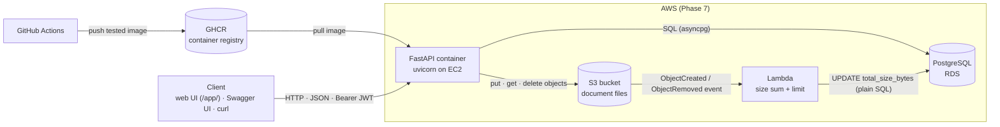
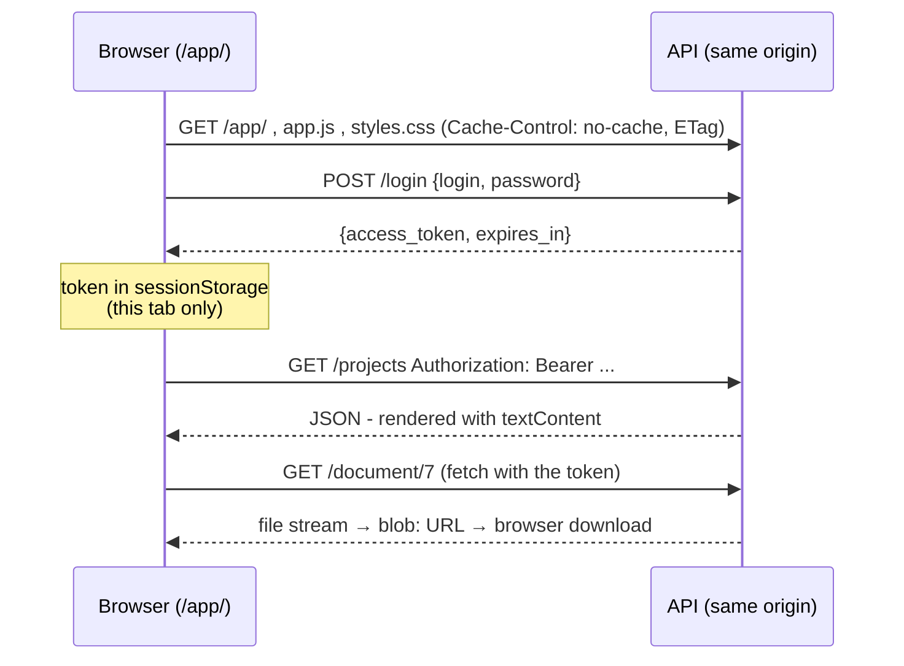
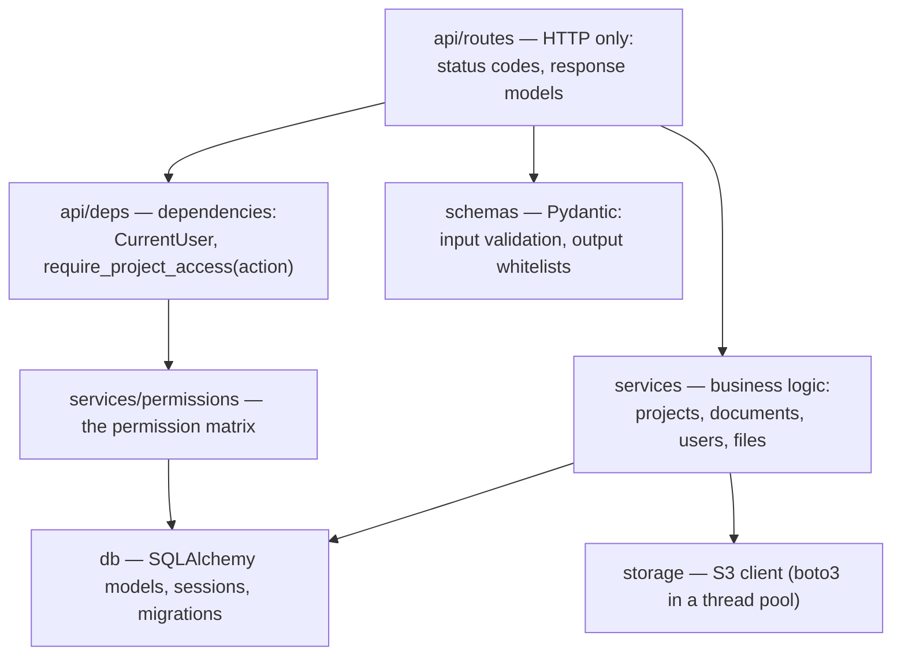
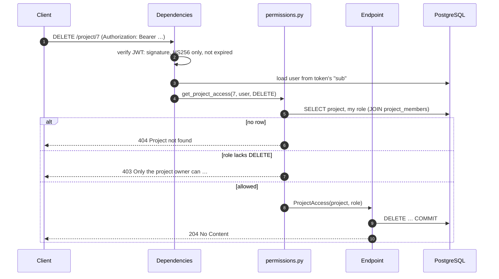
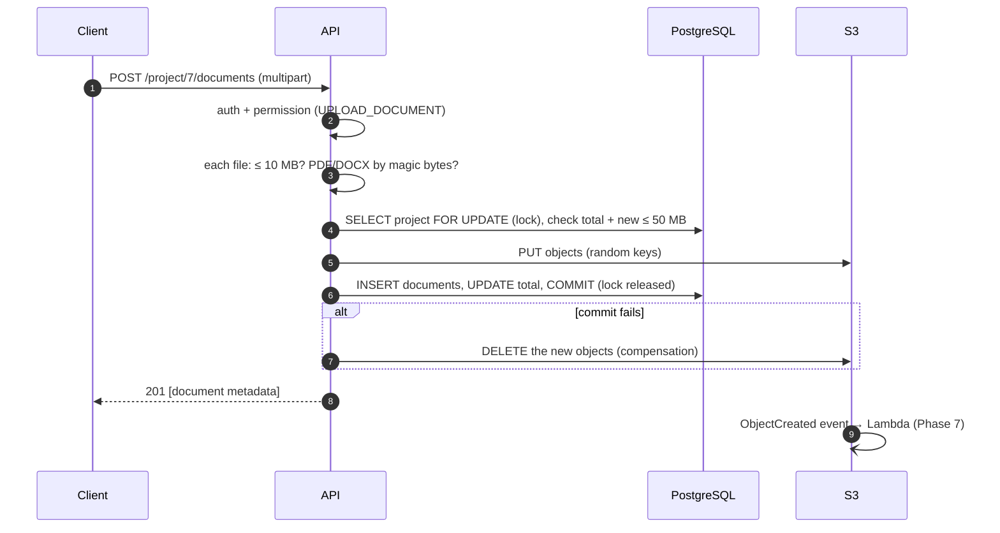
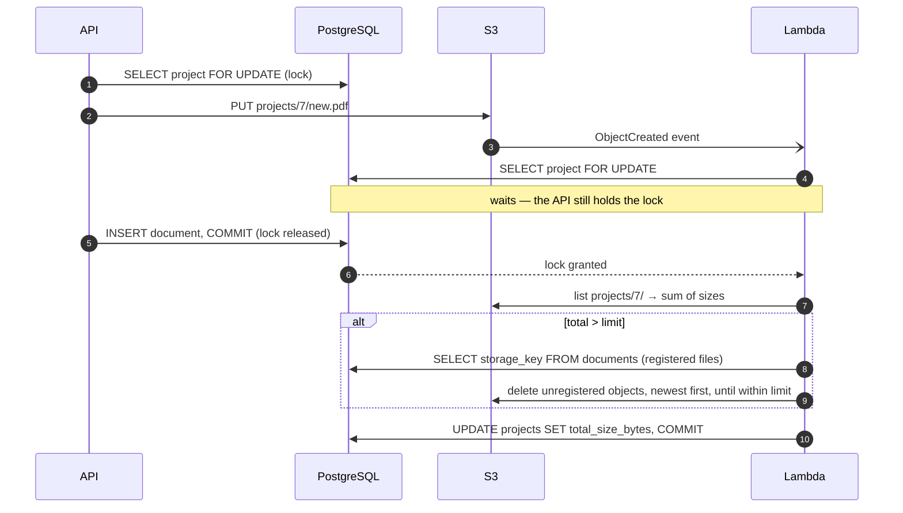
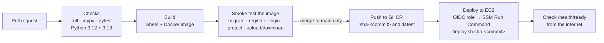

# Architecture

Project Management Dashboard is a single **FastAPI** service with a **PostgreSQL** database
for data and permissions and **Amazon S3** for document files. An **AWS Lambda** function
reacts to S3 events to keep each project's total file size correct and enforce its limit
(Phase 7). Everything is packaged as one Docker image and shipped by GitHub Actions.

## System overview

| Component | Responsibility |
|---|---|
| **API** (`src/project_dashboard`) | Authentication, authorization, validation, business rules, JSON API |
| **Web UI** (`src/project_dashboard/web`) | Plain HTML/CSS/JavaScript served by the API at `/app/`; a client of the same JSON API |
| **PostgreSQL** | Users, projects, memberships with roles, document metadata |
| **S3** | The document bytes, under `projects/{project_id}/{random}.{pdf,docx}` |
| **Lambda** (Phase 7) | On every S3 change: sum the project's file sizes, update the total, enforce the limit |
| **GHCR** | Stores the Docker image built and tested by CI |

Locally the same pieces run in Docker Compose: `db` (PostgreSQL 17), `s3` (the moto S3
emulator), `migrate` (one-off) and `api`.

## Web UI

Three static files (`index.html`, `styles.css`, `app.js`), shipped inside the Python package and
served by the API at `/app/` (`/` redirects there). No framework and no build step.

- **Same origin** as the API: no CORS needed, the token never goes to another site.
- **Its own Content-Security-Policy**: scripts, styles and requests only from this site, no
  inline code. Server data is inserted with `textContent`, never `innerHTML` (a test guards it).
- **The server decides**: the UI hides owner-only buttons for participants, but every
  permission is enforced by the API exactly as for Swagger or curl.
- **Downloads** are fetched with the `Authorization` header (a plain link cannot send it) and
  saved under the original name from `Content-Disposition: filename*=UTF-8''...`.

## Code layers

Each layer has one job:

- **Routes** translate HTTP into function calls and back. They never compare roles or
  touch the database directly.
- **Dependencies** run before an endpoint: they authenticate the caller and resolve the
  permission for the requested action. If they fail, the endpoint never runs.
- **Services** contain the logic and raise domain errors (`services/errors.py`); one central
  handler (`core/errors.py`) maps them to HTTP status codes.
- **`services/permissions.py`** is the only place where roles are compared.

## A protected request, step by step

- A missing token or invalid token returns **401** before step 4.
- Non-members get **404**, so they cannot tell a foreign project from a missing one.
- The role is read from the database on **every** request; it is never inside the token.

## Uploading a document

PostgreSQL and S3 cannot share a transaction, so the order is chosen to keep them
consistent: **writes go to S3 first, deletes go to the database first**. A database row
therefore never points to a missing file; the worst case is an unreferenced object.

## The size-limit Lambda

Code: [`functions/size_limit/size_limit.py`](../functions/size_limit/size_limit.py). It runs in the
private subnets, reaches S3 through the gateway endpoint and RDS through its security group.

- Because the Lambda takes **the same lock** as the API, it never sees an upload half-done:
  a file is either registered (committed) or was removed again by the API's compensation.
- Files the API registered are **never** deleted: the API checked the limit for them under that
  lock. The Lambda removes only objects that bypassed the API (or orphans), and corrects the
  denormalized total from S3, the source of truth for stored bytes.
- Its own deletes trigger `ObjectRemoved` events; the next run simply recomputes the same total.
  Every run is idempotent, so S3's at-least-once event delivery is harmless.
- It uses plain SQL via **pg8000** (pure Python, no compiled code in the zip) and a database user
  restricted by column-level grants ([`grants.sql`](../functions/size_limit/grants.sql)).

## Runtime and configuration

- **One process per container** (uvicorn); scaling means more containers.
- **Startup** (`lifespan`): create the database connection pool and the S3 client once.
- **Configuration** comes only from environment variables (`pydantic-settings`), validated at
  startup; secrets (`POSTGRES_PASSWORD`, `JWT_SECRET_KEY`) have no defaults. AWS credentials
  come from the instance's IAM role, never from a file.
- **TLS to the database**: on RDS, `POSTGRES_SSL_MODE=verify-full` encrypts the connection and
  verifies the server certificate against Amazon's RDS CAs (bundled in the image) and the host
  name, for the API, the migrations and the Lambda alike.
- **Health**: `GET /health` (liveness, no database) and `GET /health/ready` (readiness,
  runs `SELECT 1`, returns 503 when the database is unreachable).

## Delivery pipeline

`main` is protected by a ruleset: changes arrive only through pull requests whose three CI
jobs pass. The published image is exactly the one that passed the smoke test, and on `main` it
is deployed automatically - details in [aws.md](aws.md#continuous-deployment).
