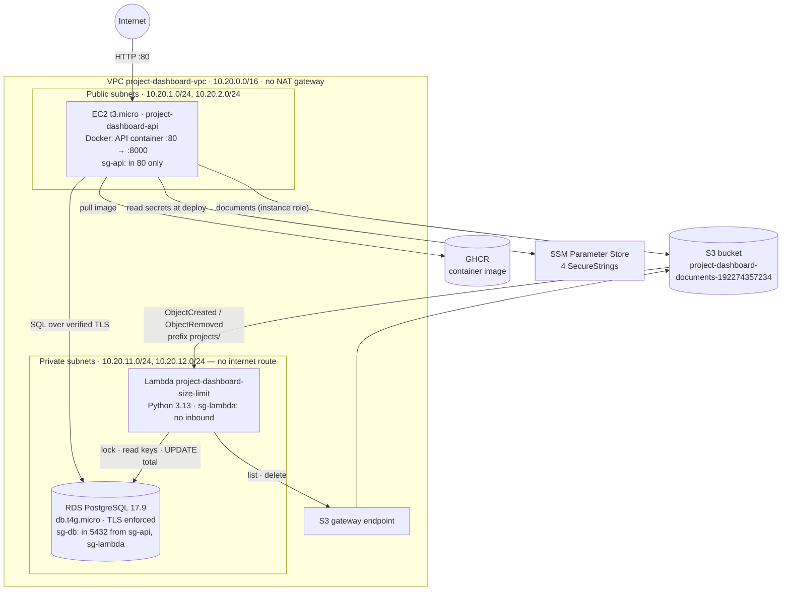
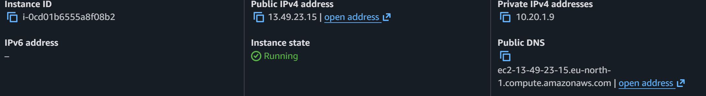
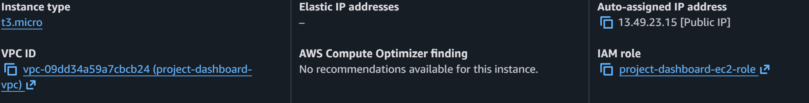
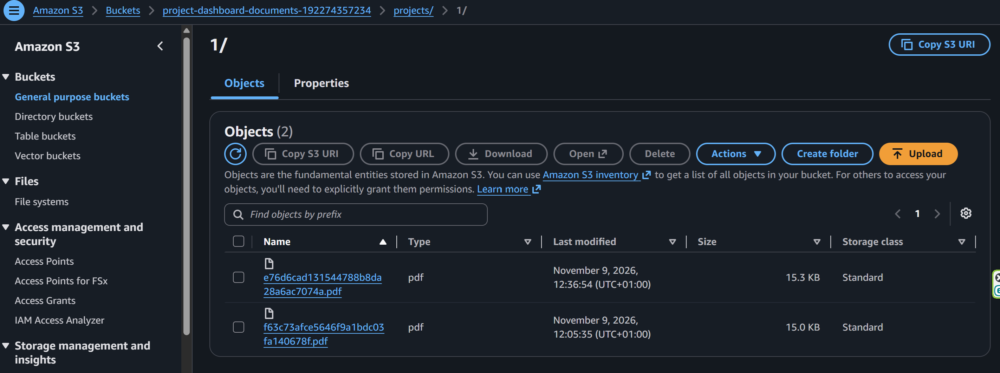
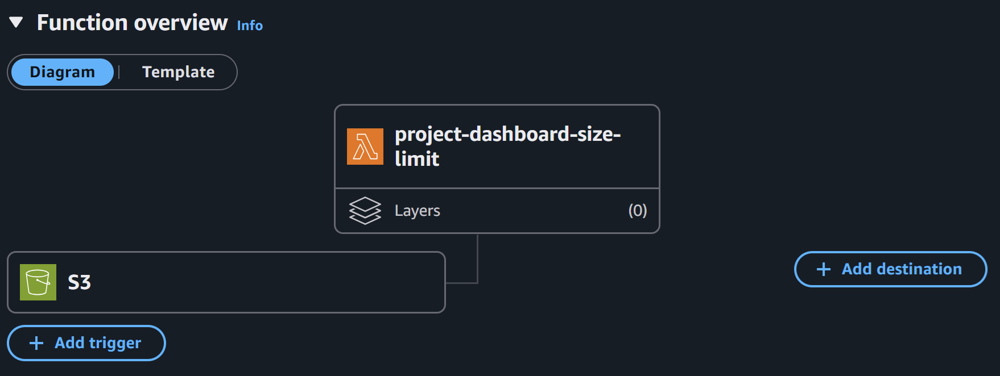
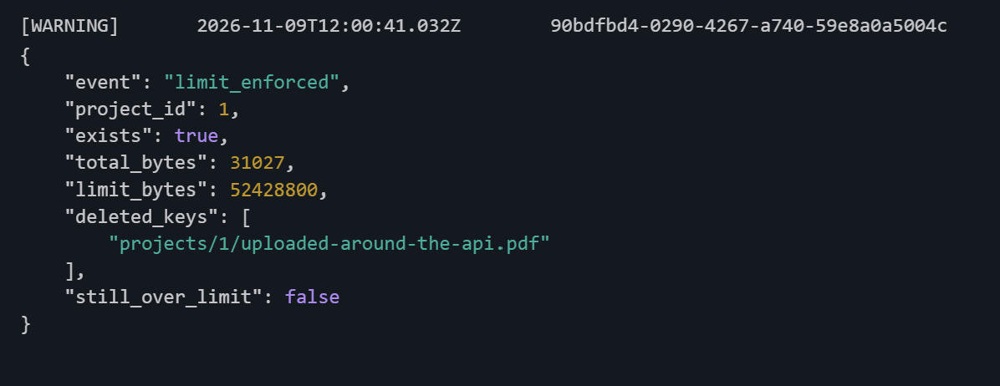
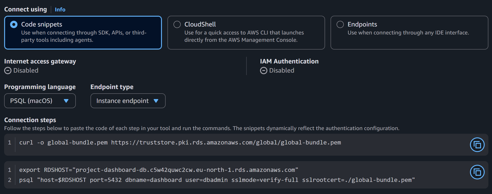

# AWS deployment

The service runs in AWS account `192274357234`, region **eu-north-1 (Stockholm)**. Every
resource carries the tag `Project = project-dashboard`. Policies and server scripts live in
[`infra/aws/`](../infra/aws/); this page explains how they fit together, how the setup was
verified, and how to operate and remove it.

**Live API:** `http://13.49.23.15/docs` (Swagger UI) while the server is running.

## Deployed architecture



## Resources

| Resource | Name / ID | Key settings |
|---|---|---|
| VPC | `project-dashboard-vpc` (`vpc-09dd34a59a7cbcb24`) | 2 AZs; 2 public + 2 private subnets; S3 gateway endpoint; **no NAT gateway** |
| Security groups | `sg-api`, `sg-db`, `sg-lambda` | rules reference each other by group, not by IP; the VPC's `default` group has no rules |
| S3 bucket | `project-dashboard-documents-192274357234` | Block Public Access on; SSE-S3; bucket owner enforced; HTTPS-only policy; multipart cleanup after 1 day; no versioning |
| RDS | `project-dashboard-db` | PostgreSQL 17.9, db.t4g.micro, gp3 20 GiB, Single-AZ, **not publicly accessible**, private subnets only, encrypted, `rds.force_ssl = 1`, backups 1 day |
| Secrets | `/project-dashboard/db/{admin,app,lambda}-password`, `/project-dashboard/jwt-secret-key` | SSM SecureString (KMS `alias/aws/ssm`), generated randomly, never written to a file in the repository |
| IAM role (EC2) | `project-dashboard-ec2-role` | `AmazonSSMManagedInstanceCore` + [`ec2-role-policy.json`](../infra/aws/ec2-role-policy.json): objects under `projects/` in the bucket, the project's 4 parameters |
| IAM role (Lambda) | `project-dashboard-lambda-role` | `AWSLambdaVPCAccessExecutionRole` + [`lambda-role-policy.json`](../infra/aws/lambda-role-policy.json): list and delete under `projects/` only |
| EC2 | `project-dashboard-api` | t3.micro, Amazon Linux 2023, public subnet, **no key pair, no SSH**, IMDSv2 required with hop limit 2, encrypted gp3 volume |
| Lambda | `project-dashboard-size-limit` | Python 3.13, 256 MB, 30 s, private subnets, S3 trigger on `projects/` |
| Account settings | — | EBS encryption by default enabled; budget alert 30 USD/month (credits excluded) |

## Security design

- **Nothing private is reachable from the internet.** RDS and the Lambda sit in subnets without
  an internet route; only port 80 of the API server is open. There is no SSH: the server is
  administered through **SSM Session Manager**, authorized by IAM and logged.
- **No long-lived AWS keys in the application.** The server and the Lambda use IAM roles and
  receive short-lived credentials from AWS. The API container reaches the instance role via
  IMDSv2 (token required; hop limit 2 because the container is one network hop further away).
- **Least privilege, verified.** Each role can touch only `projects/*` in this bucket; the
  Lambda cannot read or upload files at all. In the database:

  | User | Used by | Can do |
  |---|---|---|
  | `dbadmin` | one-time setup only | create roles and databases (RDS master user, not a superuser) |
  | `dashboard` | API and migrations | owns the database and its tables |
  | `size_lambda` | the Lambda | `SELECT (id)`, `UPDATE (total_size_bytes)` on projects; `SELECT (project_id, storage_key)` on documents — nothing else ([`grants.sql`](../functions/size_limit/grants.sql)) |

- **Encryption.** In transit: HTTPS to S3 (enforced by the bucket policy), verified TLS to RDS
  (`sslmode=verify-full` with the bundled RDS CA). At rest: S3 (SSE-S3), RDS, the EC2 volume
  and the SSM parameters (KMS).

## Setup, in order

The setup was done in the AWS console and with the AWS CLI by the account owner; each step was
verified with read-only checks before the next one.

1. **Network:** VPC wizard "VPC and more" (2 AZs, 2 public + 2 private subnets, NAT gateways
   *None*, S3 gateway endpoint), auto-assign public IPv4 on the public subnets, the three
   security groups, rules of the `default` group removed.
2. **S3 bucket** with the settings above, [`s3-bucket-policy.json`](../infra/aws/s3-bucket-policy.json)
   and [`s3-lifecycle.json`](../infra/aws/s3-lifecycle.json).
3. **Secrets:** four random values (`secrets.token_urlsafe(32)`) stored as SecureStrings.
4. **RDS:** DB subnet group with the private subnets; PostgreSQL 17.9 (the same major version as
   local development and CI), master user `dbadmin`, initial database `dashboard`.
5. **IAM roles** with the policies in `infra/aws/`.
6. **EC2** with [`user-data.sh`](../infra/aws/ec2/user-data.sh) (installs Docker), then, in Session
   Manager, the scripts from [`infra/aws/ec2/`](../infra/aws/ec2/): `first-setup.sh` runs
   [`db-setup.sql`](../infra/aws/ec2/db-setup.sql) as `dbadmin`, then `deploy.sh` (migrations and
   API as `dashboard`), then `grants.sql` for `size_lambda`. The scripts were dry-run beforehand
   against a local PostgreSQL configured like RDS (master user without superuser rights).
7. **Lambda:** the zip from `functions/size_limit/package.py` (also a CI artifact), handler
   `size_limit.handler`, environment variables for the database (password copied from SSM),
   `POSTGRES_SSL_MODE=verify-full`, `PROJECT_SIZE_LIMIT_BYTES=52428800`; S3 trigger for all
   create and delete events under `projects/`.

## Verification and evidence

### The API from the internet

| Request | Result |
|---|---|
| `GET /health/ready` | `200 {"status":"ok","database":"ok"}`: the API reaches RDS over verified TLS |
| `GET /projects` without a token | `401 {"detail":"Not authenticated"}` |
| Full scenario in Swagger UI | register → login → create project → invite → participant uploads a PDF → download → participant's delete `403` |
| Port 22 | closed |




### Documents in S3

Files are stored under random keys in the project's prefix; the original name is metadata.



### The size-limit Lambda



**Bypass test.** A 51 MiB file was copied **directly into S3** (around the API) into project 1,
which already held two documents of 15 400 and 15 627 bytes. Within two seconds the Lambda
removed it, and the total in the database became exactly the size of the registered documents:



```
12:00:41 [WARNING] {"event": "limit_enforced", "project_id": 1, "total_bytes": 31027,
                    "deleted_keys": ["projects/1/uploaded-around-the-api.pdf"], ...}
12:00:42 [INFO]    {"event": "total_updated", "project_id": 1, "total_bytes": 31027,
                    "deleted_keys": [], ...}
```

The second line is the Lambda reacting to its own delete: it recounts, finds nothing to do and
stops. Every run recomputes the whole project from S3, so repeated or retried events are harmless.

**A production bug found by this test.** The first deployment of the Lambda failed on every run
(`module 'scramp' has no attribute 'make_channel_binding'`): a new release of an indirect
dependency broke pg8000, but only on TLS connections, which the tests did not use. Fixed with
pg8000 1.31.6, a zip built from `uv.lock`, and a regression test that connects over TLS
(`tests/test_size_limit_tls.py`). AWS retried the failed event twice; the next event recounted
the project completely, so no total stayed wrong.

### The database



## Known limitations and deviations

| Topic | Situation | Production alternative |
|---|---|---|
| **HTTP only** | Tokens and passwords travel unencrypted between client and server | A domain + ACM certificate on an Application Load Balancer (~18 USD/month), or Caddy with Let's Encrypt |
| **Management account** | The workload runs in the AWS Organization's management account, which SCP guardrails never restrict (the IAM policy simulator reports misleading denies there) | A dedicated member account for the workload |
| **Changing public IP** | Stop/start gives the server a new address | An Elastic IP |
| **Lambda password** | In the function's environment variables (encrypted at rest, visible to IAM users with Lambda read rights) | Read it from SSM via an interface endpoint (~7 USD/month), or RDS IAM authentication |
| **EC2 role scope** | Still allowed to read the `admin` and `lambda` passwords needed for the one-time setup | Remove those two ARNs from `ec2-role-policy.json` after setup |
| **Single-AZ, no autoscaling** | One server, one database instance | Multi-AZ RDS, an Auto Scaling group behind a load balancer |

## Operations

**Deploy a new version** (on the server, in Session Manager):

```bash
sudo /opt/project-dashboard/deploy.sh                       # newest image (:latest)
sudo IMAGE_TAG=sha-<commit> /opt/project-dashboard/deploy.sh   # one exact build, e.g. to roll back
```

**Update the Lambda:** `uv run python functions/size_limit/package.py`, then upload
`functions/size_limit/build/size_limit.zip` in the console (Code → Upload from → .zip file) or with
`aws lambda update-function-code --function-name project-dashboard-size-limit --zip-file fileb://functions/size_limit/build/size_limit.zip`.

**Pause between sessions** to save credits: stop the EC2 instance and the RDS instance (RDS starts
again by itself after 7 days). S3, Lambda and SSM cost almost nothing at rest.

## Costs

Approximate on-demand prices in eu-north-1, covered by the account's credits:

| Resource | While running | Paused |
|---|---|---|
| EC2 t3.micro + public IPv4 | ~12 USD / month | ~1 USD (volume) |
| RDS db.t4g.micro + 20 GiB gp3 | ~14 USD / month | ~2 USD (storage) |
| S3, Lambda, SSM Standard, gateway endpoint, CloudWatch logs | cents | cents |
| **Total** | **~27 USD / month** | **~3 USD / month** |

## Teardown

In this order, so nothing is left behind or blocked by a dependency:

1. Lambda: delete the S3 trigger, then the function (its network interfaces disappear within minutes).
2. EC2: terminate `project-dashboard-api`.
3. RDS: delete `project-dashboard-db` (no final snapshot unless the data is needed), then the subnet group.
4. S3: empty the bucket, then delete it.
5. SSM: delete the four parameters under `/project-dashboard/`.
6. IAM: delete both roles (and the EC2 instance profile).
7. VPC: delete `project-dashboard-vpc` (removes subnets, route tables, internet gateway, endpoint and security groups).
8. CloudWatch: delete the log group `/aws/lambda/project-dashboard-size-limit`.
