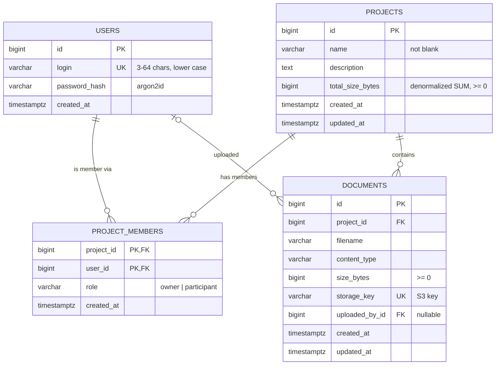

# Database design

PostgreSQL 17. The schema is defined by the SQLAlchemy models in
[`src/project_dashboard/db/models.py`](../src/project_dashboard/db/models.py), created and
evolved by Alembic migrations, and also written by hand in plain SQL in
[`schema.sql`](../src/project_dashboard/db/schema.sql). A test proves all three are identical.

## Entity-relationship diagram



## Constraints and indexes

| Table | Rule | Why |
|---|---|---|
| `users` | `UNIQUE (login)`, `CHECK char_length(login) >= 3` | One account per login; the DB is the judge, so registration is race-free |
| `projects` | `CHECK char_length(btrim(name)) > 0`, `CHECK total_size_bytes >= 0` | No blank names; the total can never go negative |
| `project_members` | `PRIMARY KEY (project_id, user_id)` | A user can be a member of a project only once |
| `project_members` | `CHECK role IN ('owner', 'participant')` | Only known roles (VARCHAR + CHECK instead of a native ENUM: easier to extend in a migration) |
| `project_members` | `UNIQUE (project_id) WHERE role = 'owner'` | **At most one owner per project** (partial unique index) |
| `project_members` | `INDEX (user_id)` | "Which projects is this user in?"; the primary key only helps lookups by `project_id` |
| `documents` | `UNIQUE (storage_key)`, `INDEX (project_id)`, `CHECK size_bytes >= 0` | One row per S3 object; fast listing per project |
| all FKs to `projects` | `ON DELETE CASCADE` | Deleting a project removes its memberships and document rows in one statement |
| `documents.uploaded_by_id` | `ON DELETE SET NULL` | A document survives if its uploader's account is removed |

All constraints follow one naming convention (`pk_users`, `uq_users_login`,
`fk_documents_project_id_projects`, `ck_projects_name_not_blank`, …), so migrations can
find and change them reliably.

## Normalization

The schema is in **third normal form (3NF)**: every fact is stored exactly once.

- **1NF**: one value per column, so there are no lists inside a cell. Members are rows in
  `project_members`, not a comma-separated column on `projects`.
- **2NF**: in `project_members`, the only non-key column `role` depends on the **whole** key
  (project, user), not on just one half of it.
- **3NF**: non-key columns depend only on their table's key. For example, a user's login lives
  only in `users`; other tables store `user_id`.

**Many-to-many**: users and projects are linked through the association table
`project_members`, one row per (project, user) pair, carrying the role.

**The owner is a membership row, not an `owner_id` column.** A separate `projects.owner_id`
would store the same fact twice and could contradict the membership table. With one source
of truth, "which projects can I access?" and "may I do X?" are both one query, and the
partial unique index guarantees exactly one owner.

## Denormalization: where and why

`projects.total_size_bytes` **deliberately duplicates** information: it always equals
`SUM(documents.size_bytes)` for the project.

| | Normalized (compute the SUM) | Denormalized (stored total), chosen |
|---|---|---|
| Size-limit check on upload | `SELECT SUM(size_bytes) … WHERE project_id = ?` on every upload, growing with the number of documents | One read of one column, and the row lock it needs anyway |
| Correctness | Always correct | Must be kept in sync: updated in the same transaction as each document change (under `SELECT … FOR UPDATE`), and recalculated from S3 by the Lambda (Phase 7) |
| Risk | None | Drift if a writer forgets to update it; briefly stale after S3-side changes until the Lambda runs |

The trade-off is worth it because the limit is checked on **every** upload, while
documents change rarely. The Lambda provides an independent recalculation from the
source of truth (S3), so any drift heals itself.

Further denormalization was considered and **rejected**:
- `projects.document_count`: nothing needs it often enough.
- Copying `users.login` into `project_members`: logins are tiny to join, and a copy could go stale.

## Data access: ORM vs. raw SQL

The application uses **SQLAlchemy 2.0 (async)** as an ORM. Raw SQL is used where it is the
better tool: [`schema.sql`](../src/project_dashboard/db/schema.sql) (the schema without an
ORM), several tests, and the Lambda function in Phase 7.

The same query, both ways: "all projects of a user, with the user's role":

```python
# ORM (services/projects.py)
select(Project, ProjectMember.role)
    .join(ProjectMember, ProjectMember.project_id == Project.id)
    .where(ProjectMember.user_id == user_id)
    .options(selectinload(Project.documents))
    .order_by(Project.id)
```

```sql
-- Raw SQL: two statements, as the ORM actually sends them
SELECT p.*, m.role
FROM projects p JOIN project_members m ON m.project_id = p.id
WHERE m.user_id = $1
ORDER BY p.id;

SELECT * FROM documents WHERE project_id = ANY($2) ORDER BY id;  -- $2 = ids from above
```

| | ORM (SQLAlchemy) | Raw SQL |
|---|---|---|
| **Safety** | Values are always bound parameters, so SQL injection is ruled out by construction | Safe only if every query uses parameters; one f-string is a vulnerability |
| **Types** | Models are typed (`Mapped[int]`); mypy checks every attribute access | Rows are untyped tuples or dicts |
| **Schema source** | Models drive Alembic autogenerate; one definition of the schema | Schema and queries maintained separately |
| **Relationships** | `selectinload` loads related rows in one extra query; `lazy="raise"` prevents hidden N+1 queries | Every join and grouping written by hand |
| **Transparency** | The generated SQL is hidden; easy to write slow queries unknowingly | You see and control exactly what runs |
| **Complex queries** | Window functions or reports can become hard to read | Often clearer for analytics and reports |
| **Dependencies / startup** | SQLAlchemy + models must be loaded | Only a driver; good for small, short-lived code such as a Lambda |

**The raw-SQL query path in practice**: the size-limit Lambda
([`size_limit.py`](../functions/size_limit/size_limit.py)) runs exactly these statements, with
bound parameters, through the pg8000 driver:

```sql
SELECT id FROM projects WHERE id = :pid FOR UPDATE;                      -- wait for the API's lock
SELECT storage_key FROM documents WHERE project_id = :pid;               -- only when over the limit
UPDATE projects SET total_size_bytes = :total WHERE id = :pid;
```

It connects as a dedicated user that may do only that
([`grants.sql`](../functions/size_limit/grants.sql)): `SELECT (id)` and `UPDATE (total_size_bytes)`
on `projects`, `SELECT (project_id, storage_key)` on `documents`. A test applies these grants to a
real role and proves both that the Lambda works and that `SELECT password_hash FROM users` is denied.

**Why this project uses the ORM for the application:** many small CRUD queries, strict
typing with mypy, migrations generated from the models, and permission queries that must
be reused consistently. **Raw SQL** is used where an ORM adds nothing: the hand-written schema,
and the Lambda, which runs one `UPDATE` and should start fast with as few dependencies as
possible.

## Reproducible schema

- `uv run alembic upgrade head` (or `python -m project_dashboard.db.migrate` in containers)
  creates or updates the schema; every migration has a `downgrade()`.
- In Docker Compose and in CI, a one-off `migrate` step runs before the API starts.
- `tests/test_schema.py` fails if the models and migrations differ (`alembic` autogenerate
  diff), or if `schema.sql` produces different columns, defaults, constraints or indexes.
- The test suite runs `upgrade head` at the start and `downgrade base` at the end, so both
  directions are exercised on every run.
- `tests/test_migrations.py` is a **stairway test** on a scratch database: for every revision,
  oldest first, it runs upgrade → downgrade → upgrade, then checks that a full downgrade leaves
  no table, sequence or type behind and that the schema can be rebuilt from nothing.

## Seed data

`python -m project_dashboard.db.seed` adds the demo users, projects and documents. It calls the
service functions (`register_user`, `create_project`, `invite_user`, `upload_documents`) instead
of writing rows directly, so the data obeys every rule the API enforces: argon2 hashes, exactly one
owner per project, files in S3 under `projects/{id}/`, and a correct `total_size_bytes`. It is
idempotent: users are looked up by login and projects by owner + name before anything is created.
Existing users keep their passwords; `--reset-passwords` explicitly sets the demo password on the
three demo accounts only (via `services/users.set_password`, a new argon2 hash and salt).
